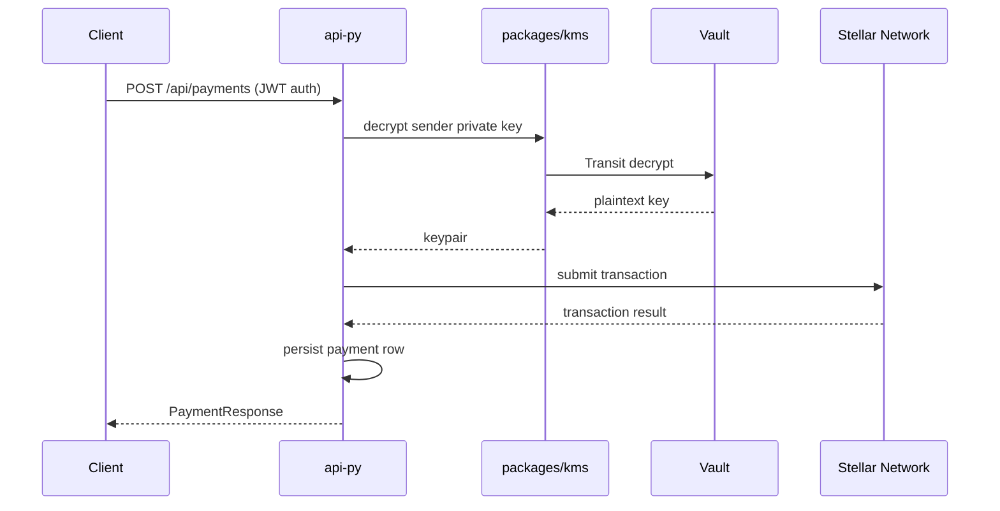
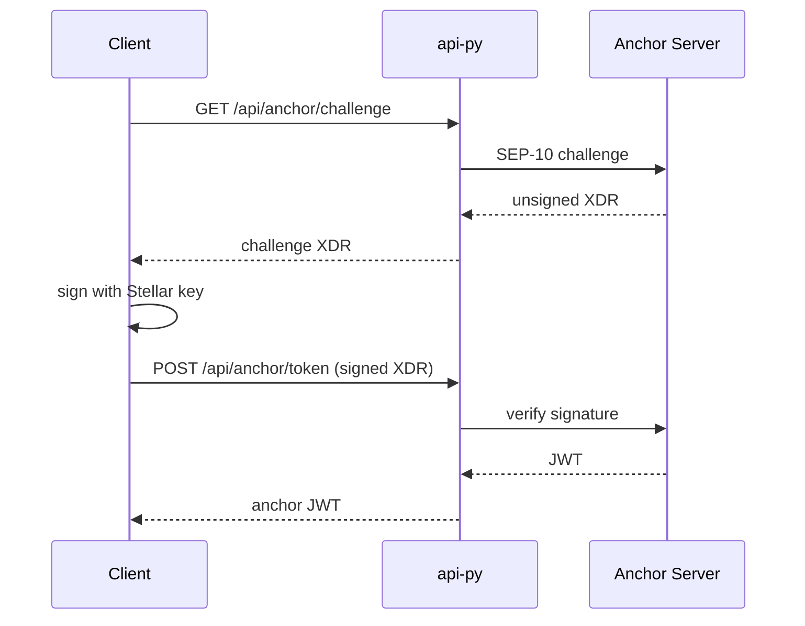

# System Architecture Overview

> Issue #1480 – accurate architecture with Mermaid diagrams.

## Monorepo Map

```
MixMatch-Onchain/
├── apps/
│   ├── api-py/          # FastAPI backend (primary)
│   ├── api/             # NestJS (legacy, decommissioning)
│   ├── web/             # Next.js frontend
│   └── mobile/          # Expo React Native
├── packages/
│   ├── shared/          # Shared TS types from OpenAPI
│   ├── stellar/         # Stellar/Soroban helpers
│   ├── kms/             # Vault Transit client
│   ├── ui/              # Shared React components
│   ├── eslint-config/
│   └── typescript-config/
├── docs/
├── loadtests/
└── scripts/
```

## Send-Payment Flow



## SEP-10 / SEP-24 Auth Flow



## Trust Boundaries

| Boundary | Direction | Protocol |
|---|---|---|
| Client → api-py | Inbound | HTTPS + JWT |
| api-py → Vault | Outbound | HTTPS + AppRole token |
| api-py → Stellar Horizon | Outbound | HTTPS |
| api-py → Anchor Server | Outbound | HTTPS (SEP-10/24) |
| api-py → Postgres | Internal | TLS optional (network-isolated) |

## Corrections from Previous Architecture Doc

- Circuit breakers exist **only** in `packages/stellar/src/escrow/pollingBackoff.ts` and the anchor service, not system-wide.
- Distributed locks are in-process (Python asyncio), not distributed.
- Taste, streaming, KMS and all packages are now included above.
