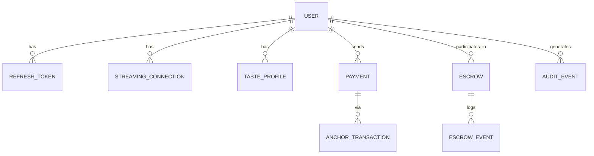

# MixMatch-Onchain Documentation Index

> Issue #1485 – centralised docs index with glossary and rendering fixes.

## Architecture & Design

- [Architecture Overview](./architecture.md)
- [API Contract](./api-contract.md)
- [Vault / KMS Configuration](./vault-kms-configuration.md)
- [Stellar SDK Compatibility](./stellar-sdk-compatibility.md)

## Decisions (ADRs)

| ADR | Status | Summary |
|---|---|---|
| [Taste Module Cron](./decisions/taste-module-cron.md) | Decided | Cron disabled by default; gated by `ENABLE_TASTE_CRON` |
| [ADR Index & Template](./decisions/adr-index.md) | Draft | Index of all architectural decisions |

## Runbooks

- [Key Rotation (Corrected)](./runbooks/key-rotation-corrected.md)
- [Steady-State Operations](./runbooks/steady-state.md)
- [Rollback Runbook](./rollback-runbook.md)
- [Traffic Splitting Cutover](./traffic-splitting-cutover.md)

## Testing

- [Test Database Strategy](./test-database-strategy.md)
- [Load Testing Guide](./load-testing-guide.md)
- [Testing Guide](./testing-guide.md)

## Modules

- [Taste Module](./taste-module.md)
- [Taste `is_mock` Guide](./taste-is-mock-guide.md)

## Glossary

| Term | Definition |
|---|---|
| **SEP-10** | Stellar Ecosystem Proposal 10 – web authentication via Stellar transactions |
| **SEP-24** | Stellar Ecosystem Proposal 24 – hosted deposit and withdrawal |
| **Trustline** | An explicit Stellar ledger entry granting permission to hold a non-XLM asset |
| **Taste profile** | A vector of genre/energy preferences inferred from listening history |
| **Deck** | The card-swipe matching UI; each card represents a potential match |
| **Escrow** | A Soroban smart contract holding funds until both parties confirm delivery |
| **Vault Transit** | HashiCorp Vault's encryption-as-a-service engine used for custodial key storage |
| **Stroop** | Smallest Stellar unit: 1 XLM = 10,000,000 stroops |

## ER Diagram (simplified)

